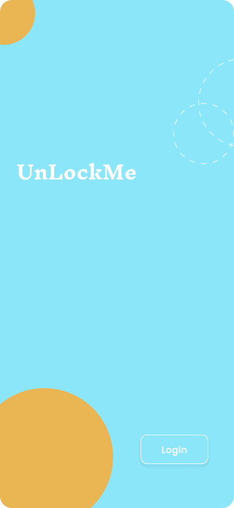
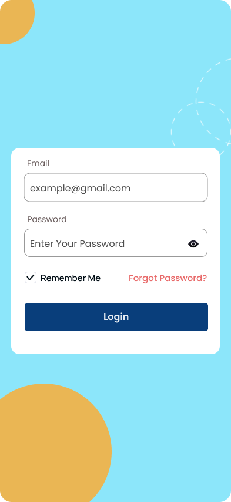
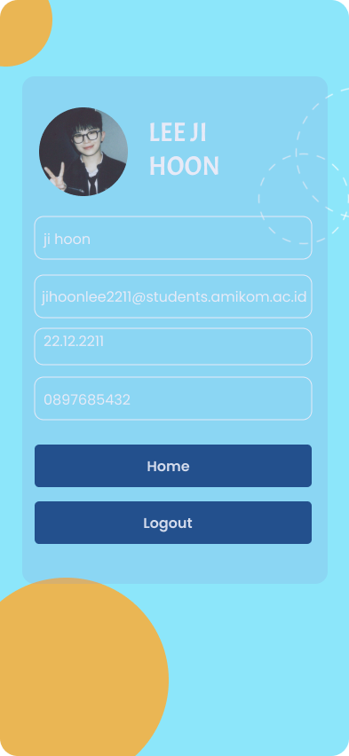
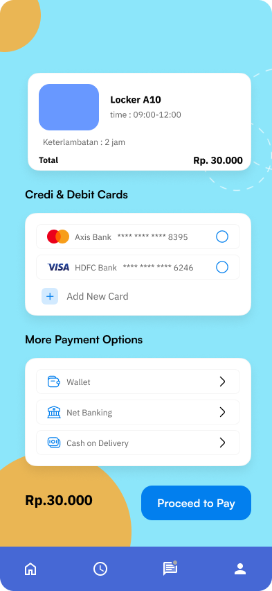
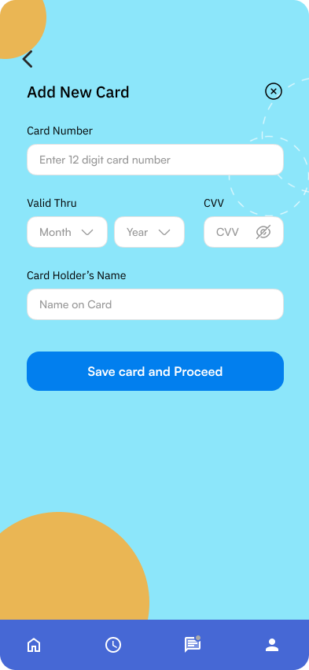
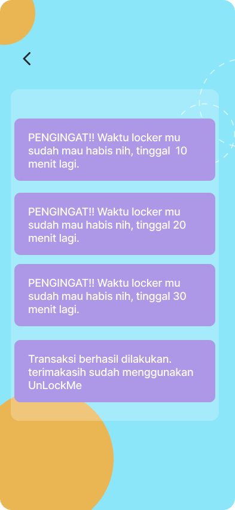
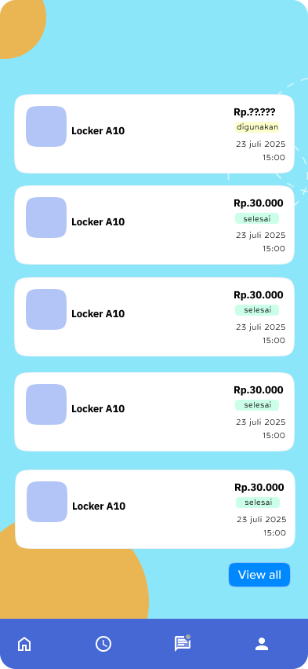

# 🔐 UnLockMe — Smart Campus Locker

UnLockMe adalah konsep UI/UX aplikasi smart locker yang dirancang untuk membantu mahasiswa menggunakan loker di lingkungan kampus dengan lebih praktis.

## 💡 Tentang Project

Project ini berfokus pada rancangan antarmuka aplikasi untuk memantau ketersediaan loker, mengakses loker menggunakan QR Code, dan memantau durasi penggunaan.

## ✨ Fitur Utama

- **Locker Availability:** Status loker ditampilkan dengan warna biru untuk loker tersedia dan merah untuk loker yang sedang digunakan.
- **QR Code Access:** QR Code pada akun pengguna digunakan untuk proses identifikasi saat membuka loker.
- **Usage Time Monitoring:** Memantau durasi penggunaan loker.
- **Notifications:** Notifikasi ketika penggunaan melewati batas waktu yang ditentukan.
- **Payment Interface:** Rancangan halaman pembayaran dan konfirmasi pembayaran.

## 🎨 Design

Antarmuka aplikasi dirancang menggunakan Figma.

## 📱 Screenshots

## 📱 UnLockMe UI/UX Design

### 1. Login

### 2. Account

### 3. Locker

### 4. QR Code

### 5. Payment

### 6. Notifications

### 7. Usage History

## 📌 Project Status

UI/UX Design Concept. Dokumentasi ini menjelaskan rancangan aplikasi dan tidak menyatakan bahwa seluruh fitur perangkat keras maupun backend sudah diimplementasikan.
